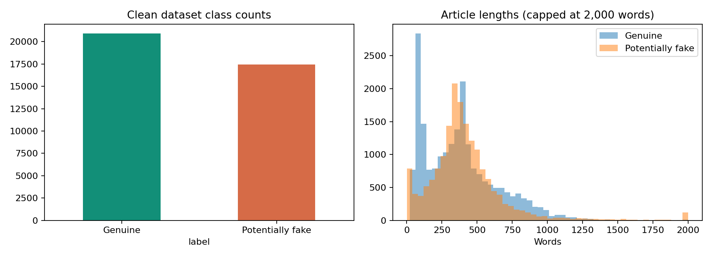
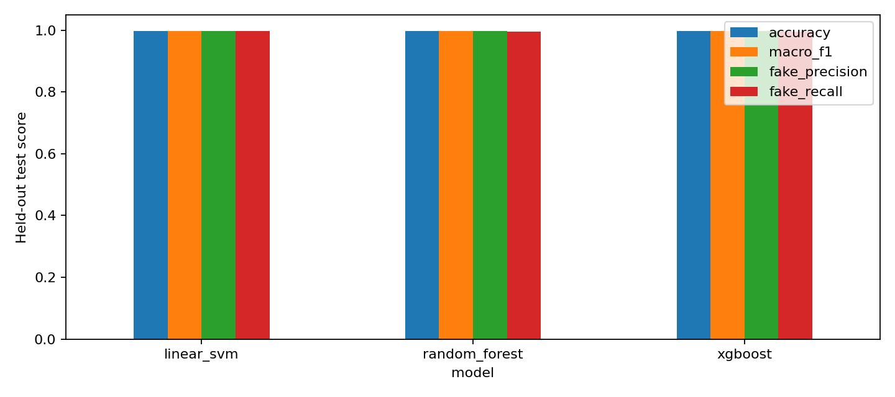
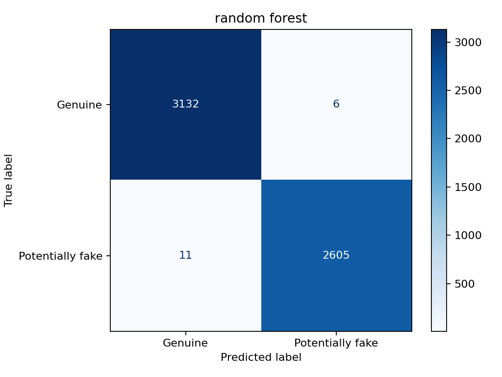
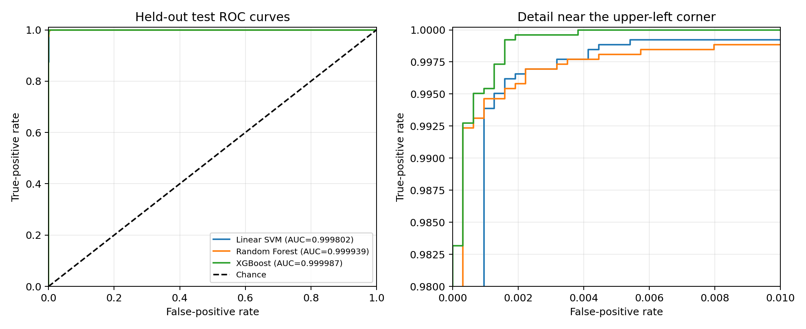

# Project Report

## 1. Cover Page

## 2. Abstract

This project develops a Fake News Detection System that classifies English news articles as **Genuine (0)** or **Potentially fake (1)** using supervised machine learning. It compares Linear Support Vector Machine (SVM), Random Forest, and XGBoost through a shared text-processing pipeline and provides a Flask interface for predictions. The supplied dataset contains 44,898 articles; removing empty bodies, normalized duplicates, and repeated article prefixes leaves 38,358 articles. Reproducible stratified training, validation, and test partitions contain 26,850, 5,754, and 5,754 articles respectively.

The representation combines 3,000 chi-square-selected TF-IDF word features with eight standardized linguistic features. Model hyperparameters are tuned through three-fold stratified cross-validation on a 6,000-article training-only sample. Random Forest is selected for deployment by validation macro F1. On the held-out test set it achieves **99.7046% accuracy**, **0.997021 macro F1**, and **0.999939 ROC AUC**. Linear SVM and XGBoost each achieve **99.7393% test accuracy**. These results demonstrate strong classification within the supplied dataset, while publisher and stylistic cues limit claims about generalization. The system recognizes textual patterns and does not independently verify factual claims.

## 3. Introduction

### 3.1 Background and problem definition

Online news can spread rapidly, making manual review of every article impractical. Automated text classification can support initial screening by identifying patterns associated with labeled genuine and fake articles. However, a classifier trained on historical examples may learn publisher identity, writing style, or topic rather than factual accuracy. This project therefore studies both predictive performance and the limitations of the dataset.

The task is binary article classification. Given an optional title and a required article body, the system predicts one of the two dataset-derived classes. Labels originate from the input files; the project does not independently adjudicate their truthfulness.

### 3.2 Objectives

1. Audit the dataset and reduce duplicate overlap before splitting.
2. Build a reusable pipeline for cleaning, TF-IDF extraction, feature selection, and linguistic features.
3. Compare Linear SVM, Random Forest, and XGBoost under a common evaluation procedure.
4. Study vocabulary selection and the contribution of linguistic features using validation experiments.
5. Evaluate classification quality, ranking quality, runtime, artifact size, and errors.
6. Serve the selected saved pipeline through a browser interface and JSON API.

### 3.3 Scope

The implementation covers English article text, local training, saved model artifacts, generated evaluation reports, and Flask inference. Subject and date metadata are inspected but excluded from the classifier. Social-network propagation, image analysis, evidence retrieval, multilingual classification, and production-scale hosting are outside the implemented scope.

## 4. Literature Survey

| Research or solution | Main idea | Relationship to this project |
| --- | --- | --- |
| Joachims (1998), *Text Categorization with Support Vector Machines: Learning with Many Relevant Features* | Studies SVMs for sparse, high-dimensional text classification. | Supports Linear SVM as the text-classification baseline. [Paper](https://www.cs.cornell.edu/People/tj/publications/joachims_98a.pdf). |
| Breiman (2001), *Random Forests* | Combines randomized decision trees into an ensemble. | Motivates comparison with a nonlinear tree ensemble. [Paper](https://doi.org/10.1023/A%3A1010933404324). |
| Chen and Guestrin (2016), *XGBoost: A Scalable Tree Boosting System* | Describes scalable tree boosting, including techniques for sparse data. | Motivates the boosted-tree model used in the experiments. [Paper](https://arxiv.org/abs/1603.02754). |
| Wang (2017), *“Liar, Liar Pants on Fire”: A New Benchmark Dataset for Fake News Detection* | Introduces a benchmark for evaluating fake-news detection. | Provides a relevant external benchmark for future evaluation; LIAR is not used in the reported experiments. [Paper](https://aclanthology.org/P17-2067/). |
| University of Victoria ISOT dataset documentation | Describes a corpus of genuine and fake news, with class and subject counts matching the supplied files. | Provides the dataset-family reference; the repository does not record the exact download history of its local copy. [Dataset documentation](https://onlineacademiccommunity.uvic.ca/isot/wp-content/uploads/sites/7295/2023/02/ISOT_Fake_News_Dataset_ReadMe.pdf). |

The implemented baseline uses TF-IDF with Linear SVM. Random Forest and XGBoost provide alternative decision rules on the same representation. An all-terms SVM configuration and a selected-TF-IDF-only SVM configuration serve as feature baselines. TF-IDF is a representation, rather than a classifier. The scikit-learn documentation describes TF-IDF extraction and chi-square selection used in this pipeline. [Text feature extraction](https://scikit-learn.org/stable/modules/feature_extraction.html#text-feature-extraction), [feature selection](https://scikit-learn.org/stable/modules/feature_selection.html).

The literature motivates the methods; published scores are not treated as directly comparable to this project's results because datasets, cleaning rules, and partitions may differ.

## 5. Dataset Description

### 5.1 Source and schema

The project reads [archive/true.csv](archive/true.csv) and [archive/fake.csv](archive/fake.csv). Their row counts and subject distributions match the ISOT corpus documentation cited above. The locally supplied files are the actual experimental inputs.

| Column | Meaning | Use |
| --- | --- | --- |
| `title` | Article headline | Combined with the body as classifier input; optional during inference. |
| `text` | Article body | Required classifier input. |
| `subject` | Dataset topic category | Exploratory analysis only. |
| `date` | Publication-date metadata | Excluded from classifier inputs. |
| `label` | Added by the loader: 0 for `true.csv`, 1 for `fake.csv` | Target variable. |
| `source_row`, `content_hash`, `prefix_hash` | Generated identifiers | Audit and split-integrity checks only. |

### 5.2 Size and class distribution

| Dataset stage | Genuine (0) | Potentially fake (1) | Total |
| --- | ---: | ---: | ---: |
| Raw input | 21,417 | 23,481 | 44,898 |
| Cleaned dataset | 20,918 | 17,440 | 38,358 |
| Training | 14,642 | 12,208 | 26,850 |
| Validation | 3,138 | 2,616 | 5,754 |
| Test | 3,138 | 2,616 | 5,754 |

After cleaning, genuine articles constitute **54.53%** and potentially fake articles **45.47%**. Stratification preserves approximately these proportions in every partition. No class resampling is implemented.

Genuine subjects are `politicsNews` and `worldnews`. Fake-labeled subjects are `News`, `politics`, `left-news`, `Government News`, `US_News`, and `Middle-east`. These category sets differ between classes. The raw dataset contains a Reuters marker in **99.82% of genuine bodies** and **1.31% of fake-labeled bodies**, creating a strong source-related cue.

In the cleaned dataset, mean body length is approximately 384.74 words for genuine articles and 425.01 for potentially fake articles. The observed ranges are 22–5,172 and 1–8,135 words respectively, according to the exploratory report.



*Figure 1. Existing exploratory dataset visualization.*

Evidence: [dataset summary](reports/dataset_summary.json), [exploration summary](reports/exploration_summary.json), and [split manifest](reports/split_manifest.csv).

## 6. Data Preprocessing

### 6.1 Missing values and normalization

Missing titles and bodies are replaced with empty strings. Empty cleaned bodies are removed, while an absent title is allowed. Cleaning decodes HTML entities, removes HTML tags, applies Unicode NFKC normalization, collapses whitespace, and trims text. Case and punctuation remain available for linguistic extraction; TF-IDF lowercases its input internally. The implemented pipeline does not apply stemming, lemmatization, or a separate stop-word-removal list.

### 6.2 Duplicate handling

For duplicate auditing, the body is lowercased and represented by normalized word tokens. A SHA-256 hash identifies repeated normalized bodies. A second hash represents the first 200 normalized body words. All rows in a conflicting-label body or prefix group would be removed; other duplicate groups retain one article.

| Cleaning operation | Rows removed |
| --- | ---: |
| Empty article bodies | 631 |
| Conflicting-label body groups | 0 |
| Normalized exact duplicate bodies | 5,899 |
| Conflicting-label prefix groups | 0 |
| Repeated first-200-word prefixes | 10 |
| **Total removed** | **6,540** |

The prefix rule reduces a specific kind of near duplication. It does not detect every paraphrase, revision, or syndicated article.

### 6.3 Outliers, feature engineering, and scaling

Article-length distributions are inspected during exploration. No statistical outlier-removal or clipping rule is implemented, so nonempty unusually short or long articles remain in training. The web interface separately requires at least ten body words and limits bodies to 50,000 characters and titles to 300 characters.

Title and body are concatenated for feature extraction. Eight linguistic features describe length, capitalization, and punctuation. `StandardScaler` fits their means and standard deviations on training data. TF-IDF vectors use the vectorizer's default L2 normalization. Linguistic features are appended after chi-square selection so that chi-square operates on nonnegative TF-IDF values.

### 6.4 Splitting and leakage control

The cleaned dataset uses stratified **70% training / 15% validation / 15% test** partitions with seed **42**, subject to integer rounding. Duplicate removal precedes splitting. The split manifest records identifiers to check that retained body and prefix groups do not cross partitions. TF-IDF, feature selection, and scaling fit only on training data, including within each cross-validation fold. Validation is used for feature configuration and deployment selection; test data is reserved for final reporting.

## 7. Methodology

### 7.1 Architecture and workflow

```text
Local genuine/fake CSV files
    -> Label assignment, cleaning, and duplicate audit
    -> Stratified train / validation / test partitions
    -> Title + body
    -> Shared text cleaner
       -> TF-IDF -> Chi-square term selection
       -> Eight linguistic features -> Standard scaling
    -> Feature union
    -> Linear SVM / Random Forest / XGBoost
    -> Validation-based deployment selection
    -> Held-out test evaluation
    -> Saved pickle pipeline -> Flask form and prediction API
```

### 7.2 TF-IDF representation

The vectorizer uses word unigrams and bigrams, a maximum vocabulary of **12,000 terms**, `min_df=3`, `max_df=0.98`, and sublinear term frequency. With term count `c(t,d)`, document frequency `df(t)`, and training-document count `N`, the configured weighting can be expressed as:

```text
tf(t,d) = 1 + ln(c(t,d))                 when c(t,d) > 0
idf(t)  = ln((1 + N) / (1 + df(t))) + 1
weight(t,d) = tf(t,d) * idf(t)
x_d = weight_vector_d / ||weight_vector_d||_2
```

Absent terms receive zero weight. Smoothed IDF and L2 normalization follow the vectorizer defaults. [scikit-learn TF-IDF documentation](https://scikit-learn.org/stable/modules/feature_extraction.html#text-feature-extraction).

### 7.3 Chi-square selection and linguistic features

Chi-square scores measure association between nonnegative term features and class labels. Conceptually, the statistic compares observed and expected feature mass across classes:

```text
chi2(t) = sum_over_classes ((Observed(t,c) - Expected(t,c))^2 / Expected(t,c))
```

SVM validation experiments compare 3,000, 6,000, and all available terms. The selected count is **3,000**, shared by all model families. Adding eight linguistic features produces **3,008 input features**.

| Linguistic feature | Implemented definition |
| --- | --- |
| Word count | Number of matches to the word-token regular expression. |
| Sentence count | Number of punctuation groups matching `[.!?]+`, with a minimum of one. |
| Mean word length | Total word-token characters divided by word count. |
| Mean sentence length | Word count divided by the sentence-count approximation. |
| Uppercase ratio | Uppercase characters divided by alphabetic-character count. |
| Punctuation ratio | Non-alphanumeric, non-whitespace characters divided by text length. |
| Exclamations per word | Exclamation marks divided by word count. |
| Questions per word | Question marks divided by word count. |

Denominators are protected against division by zero. Sentence count is a punctuation heuristic rather than a linguistic sentence parser. Scaling uses `z_j = (x_j - mean_train,j) / std_train,j`.

### 7.4 Classification algorithms

**Linear SVM:** `LinearSVC` learns a linear decision boundary. For mathematical description, map class labels to `y_i ∈ {-1,+1}`. Its default squared-hinge formulation is represented by:

```text
minimize  0.5 * ||w||^2 + C * sum_i max(0, 1 - y_i * (w^T x_i + b))^2
```

This expression summarizes the main loss and weight penalty; the library also handles the fitted intercept. The selected value is `C=2.0`, with `max_iter=5000`.

**Random Forest:** An ensemble of 120 randomized trees aggregates tree class probabilities and predicts the class with the largest mean probability. The model uses square-root feature sampling and a minimum leaf size of two. Unlimited maximum depth is selected.

**XGBoost:** Additive boosted trees optimize a regularized classification objective, summarized as:

```text
F(x) = sum_k f_k(x)
Objective = sum_i classification_loss(y_i, F(x_i)) + sum_k regularization(f_k)
```

The implementation uses 140 trees, learning rate 0.12, histogram tree construction, row subsampling 0.9, column subsampling 0.8, and selected maximum depth six. Binary classification uses the classifier's logistic objective; `logloss` is configured as its evaluation metric. [XGBoost API](https://xgboost.readthedocs.io/en/stable/python/python_api.html).

### 7.5 Training and deployment

Feature experiments fit SVM with `C=1` on the training partition and compare validation macro F1. Each model then undergoes training-only cross-validation for its hyperparameters. The chosen configuration is fitted on all 26,850 training articles. Deployment selection compares validation macro F1 across these fitted models.

Random Forest is saved as [models/best_pipeline.pkl](models/best_pipeline.pkl). The exported models remain fitted on the training partition; validation articles are not added through a final refit. Flask loads the complete saved pipeline at startup and exposes `/` and `POST /api/predict`. It validates inputs and returns a label, class ID, model name, and limitations note. Submitted articles are not persisted, and no confidence percentage is returned.

## 8. Experimental Setup

### 8.1 Software and hardware records

| Component | Recorded version or configuration |
| --- | --- |
| Python | 3.13.3, recorded in the training manifest. |
| scikit-learn | 1.7.2, recorded in the training manifest. |
| XGBoost | 3.4.1, recorded in the training manifest. |
| NumPy | 2.3.3, recorded in the training manifest. |
| pandas | 2.3.2, recorded in the training manifest. |
| Flask | 3.1.2, pinned in `requirements.txt`. |
| Matplotlib | 3.10.6, pinned in `requirements.txt`. |
| Persistence | Python built-in pickle. |
| Execution | Python modules/scripts; local Flask application. |
| Random seed | 42. |
| Hardware | CPU model, RAM, and original training-machine specifications are not recorded. |

The current workspace uses Windows and PowerShell. The manifest does not establish the original training operating system or hardware. Timing results therefore describe the saved run and should not be treated as hardware-independent benchmarks. Tree-model training defaults to one worker; the command line supports a configurable worker count. No GPU training is configured.

### 8.2 Hyperparameter tuning and cross-validation

`GridSearchCV` uses macro F1, three-fold `StratifiedKFold`, shuffling, and seed 42. The saved run uses a stratified 6,000-row subset of the training partition. Each model has two candidates, giving six fold fits per model. Preprocessing is fitted inside the pipeline for each fold. Grid search uses one job, and the final model is fitted separately on the full training partition.

| Model | Candidate parameter values | Selected value | Best CV macro F1 | Tuning time (s) |
| --- | --- | --- | ---: | ---: |
| Linear SVM | `C`: 0.5, 2.0 | 2.0 | 0.993445 | 55.47 |
| Random Forest | `max_depth`: 25, unlimited | Unlimited | 0.995127 | 66.50 |
| XGBoost | `max_depth`: 3, 6 | 6 | 0.996300 | 92.54 |

The search is intentionally small. Equal candidate and fold counts do not imply equal model capacity or exhaustive optimization. Feature count is chosen using the separate validation set, so these CV scores are not estimates from a fully nested model-selection procedure.

Evidence: [training manifest](models/manifest.json), [requirements](requirements.txt), and the per-model `reports/*_cv_results.csv` files.

## 9. Results and Evaluation

All reported results below refer to existing saved experiments. The ROC figure is generated from their saved test labels and decision scores without retraining.

### 9.1 Metrics

Class 1 is the positive, potentially fake class. `TP`, `TN`, `FP`, and `FN` denote true positives, true negatives, false positives, and false negatives.

```text
Accuracy  = (TP + TN) / (TP + TN + FP + FN)
Precision = TP / (TP + FP)
Recall    = TP / (TP + FN)
F1        = 2 * Precision * Recall / (Precision + Recall)
Macro F1  = (F1_class0 + F1_class1) / 2
FPR       = FP / (FP + TN)
TPR       = TP / (TP + FN)
```

ROC AUC evaluates score ranking across thresholds. Average precision summarizes precision-recall ranking. SVM uses decision-function scores, while the tree models use positive-class probabilities. These scores have not undergone probability calibration.

**RMSE is not reported:** this is a classification task with discrete class labels, rather than prediction of a continuous target. Classification and ranking metrics are the relevant evaluation measures; adding regression RMSE would not establish classification reliability.

### 9.2 Validation and deployment selection

| Model | Validation accuracy (%) | Validation macro F1 |
| --- | ---: | ---: |
| Linear SVM | 99.6698 | 0.996669802 |
| **Random Forest** | **99.7046** | **0.997020349** |
| XGBoost | 99.7046 | 0.997020156 |

Random Forest has the highest unrounded validation macro F1 and is therefore deployed. Its advantage over XGBoost is approximately **0.000000192**, despite identical validation accuracy. This very small difference does not establish a meaningful general superiority of Random Forest.

### 9.3 Held-out test performance

| Model | Accuracy (%) | Macro F1 | Fake precision | Fake recall | Fake F1 | ROC AUC | Average precision |
| --- | ---: | ---: | ---: | ---: | ---: | ---: | ---: |
| Linear SVM | 99.7393 | 0.997371 | 0.997323 | 0.996942 | 0.997132 | 0.999802 | 0.999794 |
| Random Forest | 99.7046 | 0.997021 | 0.997702 | 0.995795 | 0.996748 | 0.999939 | 0.999929 |
| XGBoost | 99.7393 | 0.997371 | 0.998467 | 0.995795 | 0.997129 | 0.999987 | 0.999985 |

Linear SVM and XGBoost each make 15 test errors, while Random Forest makes 17. SVM has the highest test macro F1 at full precision. Test results do not change the previously selected deployment model. XGBoost's ROC AUC is extremely high but below 1.0; rounding it to four decimal places would conceal this distinction.



*Figure 2. Existing comparison of held-out classification metrics.*

### 9.4 Confusion matrices

The counts below are calculated from the saved prediction CSV files. Rows are actual classes and columns are predicted classes.

| Model | Actual genuine, predicted genuine (TN) | Actual genuine, predicted fake (FP) | Actual fake, predicted genuine (FN) | Actual fake, predicted fake (TP) |
| --- | ---: | ---: | ---: | ---: |
| Linear SVM | 3,131 | 7 | 8 | 2,608 |
| Random Forest | 3,132 | 6 | 11 | 2,605 |
| XGBoost | 3,134 | 4 | 11 | 2,605 |


*Figure 3. Linear SVM test confusion matrix.*



*Figure 4. Random Forest test confusion matrix.*


*Figure 5. XGBoost test confusion matrix.*

### 9.5 ROC curves



*Figure 6. ROC curves calculated from saved test labels and decision scores. The second panel enlarges the upper-left region because the full curves nearly overlap. The dashed diagonal represents chance-level ranking.*

### 9.6 Feature experiments

These experiments use Linear SVM with `C=1` and evaluate the validation partition.

| Selected terms | Linguistic features | Total features | Validation accuracy (%) | Validation macro F1 |
| --- | --- | ---: | ---: | ---: |
| 3,000 | Yes | 3,008 | 99.7393 | 0.997371 |
| 6,000 | Yes | 6,008 | 99.7219 | 0.997196 |
| All (12,000) | Yes | 12,008 | 99.6698 | 0.996670 |
| 3,000 | No | 3,000 | 99.6003 | 0.995968 |

Selecting 3,000 terms instead of all terms improves validation macro F1 by approximately **0.000701**. Adding linguistic features at this term count improves it by approximately **0.001403**. These are observed SVM validation differences, not established effects for every model. The feature-experiment SVM uses a different `C` from the final tuned SVM, explaining why its validation score can differ.

### 9.7 Computational performance

| Model | Final training time (s) | Batch prediction time per article (ms) | Serialized size (MiB) |
| --- | ---: | ---: | ---: |
| Linear SVM | 56.03 | 0.7265 | 0.6012 |
| Random Forest | 67.06 | 0.7918 | 15.3605 |
| XGBoost | 52.04 | 0.7642 | 0.8082 |

Training times exclude hyperparameter tuning and feature experiments. Prediction timing measures `predict` over the complete test batch, divided by its article count. It excludes model loading, separate score extraction, and HTTP overhead. Artifact sizes use bytes divided by `1024^2`. SVM provides the smallest artifact and lowest measured batch prediction latency in this run.

Evidence: [test comparison](reports/model_comparison.csv), [validation comparison](reports/validation_comparison.csv), [feature experiments](reports/feature_experiments.csv), and [classification reports](reports/classification_reports/).

## 10. Discussion

### 10.1 Error analysis

False positives flag genuine articles as potentially fake, while false negatives classify fake-labeled articles as genuine. Random Forest produces six false positives and eleven false negatives. SVM reduces false negatives to eight, while XGBoost reduces false positives to four. The choice of metric therefore matters when assessing different kinds of error.

Misclassified titles and article excerpts are retained in [SVM errors](reports/linear_svm_errors.csv), [Random Forest errors](reports/random_forest_errors.csv), and [XGBoost errors](reports/xgboost_errors.csv). These support manual investigation. The reports do not establish verified causes for individual errors, so specific claims about satire, quotations, or ambiguous reporting require further review.

A linear model can combine many sparse text signals, while trees represent nonlinear splits and interactions. These mechanisms offer plausible explanations for performance differences, but the experiments do not isolate a causal explanation. Only one fixed article split and a small tuning grid are reported; confidence intervals and statistical significance tests are not provided.

### 10.2 Feature interpretation

| Term | Training chi-square score |
| --- | ---: |
| `reuters` | 314.9533 |
| `video` | 278.2368 |
| `you` | 226.5156 |
| `via` | 216.9766 |
| `image` | 200.6434 |

These highly ranked terms indicate association with dataset labels. Chi-square scores do not show the direction of association, prove factual unreliability, or provide model-specific feature importance. The strength of `reuters`, together with the measured source-marker distribution, supports concern that source identity contributes to the task. Random Forest impurity importance, SVM coefficient analysis, and SHAP explanations are not included in the existing reports.

### 10.3 Limitations and edge cases

- **Source and topic bias:** Label-specific subject categories and Reuters attribution can reward source/style recognition despite exclusion of metadata columns.
- **Generalization:** A random article split does not test unseen publishers, chronological shifts, current news, other languages, or unrelated domains.
- **Duplicate coverage:** Hashes and the 200-word-prefix heuristic cannot identify every semantic duplicate.
- **Validation reuse:** Feature choices and deployment selection use the same validation partition, introducing possible selection optimism. The test partition remains separate.
- **Input mismatch:** Training retains nonempty articles shorter than ten words; the web interface rejects such submissions. Headlines alone are unsupported.
- **Language and formatting:** Unusual capitalization, punctuation, quotations, or unseen vocabulary may alter predictions; these edge cases have not been separately benchmarked.
- **Truth verification:** No external evidence or knowledge source is consulted. Fluent misinformation and genuine sensational writing may be difficult to distinguish through text patterns alone.
- **Confidence:** Scores are not calibrated, and the application does not display a probability of factual truth.

## 11. Conclusion

The project implements a complete local workflow from dataset auditing and duplicate reduction to feature extraction, model comparison, held-out evaluation, and Flask inference. A combination of 3,000 selected TF-IDF terms and eight linguistic features provides a compact shared representation. Validation experiments favor this representation over the tested all-terms and text-only SVM baselines.

Random Forest is deployed according to the predefined validation macro-F1 criterion and achieves 99.7046% held-out accuracy. Linear SVM and XGBoost each achieve 99.7393%; SVM also offers the smallest saved artifact. The close results support comparing quality and computational cost together, while the tiny validation selection margin should be interpreted cautiously.

The main contributions are a reproducible comparison of three classifiers, training-only fitted preprocessing, recorded feature experiments, auditable predictions and errors, and integration of the selected pipeline with an application. The practical takeaway is that high performance on this dataset establishes recognition of its label-associated text patterns. Broader fake-news screening requires evaluation that separates factual signals from publisher and stylistic cues.

## 12. Future Work

1. Evaluate publisher-disjoint and chronological partitions, together with external corpora. Adapt label mappings explicitly when using datasets such as LIAR.
2. Mask source markers such as Reuters in controlled experiments to quantify dependence on attribution and publisher style.
3. Improve duplicate detection using similarity methods while keeping related article groups within one partition.
4. Extend training-only tuning, repeat experiments across seeds, and report uncertainty intervals. Use nested selection when estimating the full model-selection procedure.
5. Compare additional text baselines, contextual language models, and transformer architectures under the same split controls.
6. Add evidence retrieval and claim-level reasoning so that textual screening can be supplemented by factual evidence.
7. Study probability calibration, threshold selection, and an abstention option for uncertain or unfamiliar inputs.
8. Add model-specific explanations and structured manual review of errors, including quotations, satire, and short articles.
9. Establish multilingual benchmarks and robust preprocessing for languages beyond the present English corpus.
10. For deployment, introduce versioned datasets and artifacts, reproducible environments, API load testing, drift monitoring, documented retraining criteria, and privacy-conscious operational logging. These are proposed MLOps improvements rather than existing features.

## 13. References

1. Joachims, T. (1998). *Text Categorization with Support Vector Machines: Learning with Many Relevant Features*. ECML-98, pp. 137–142. [Author-hosted paper](https://www.cs.cornell.edu/People/tj/publications/joachims_98a.pdf).
2. Breiman, L. (2001). *Random Forests*. Machine Learning, 45, pp. 5–32. [DOI](https://doi.org/10.1023/A%3A1010933404324).
3. Chen, T., and Guestrin, C. (2016). *XGBoost: A Scalable Tree Boosting System*. KDD 2016. [Paper](https://arxiv.org/abs/1603.02754).
4. Wang, W. Y. (2017). *“Liar, Liar Pants on Fire”: A New Benchmark Dataset for Fake News Detection*. ACL 2017, Volume 2, pp. 422–426. [ACL Anthology](https://aclanthology.org/P17-2067/).
5. University of Victoria, ISOT Research Lab. *ISOT Fake News Dataset ReadMe*. [Dataset documentation](https://onlineacademiccommunity.uvic.ca/isot/wp-content/uploads/sites/7295/2023/02/ISOT_Fake_News_Dataset_ReadMe.pdf). The supplied local CSV files are consistent with the documented counts; their exact download provenance is not recorded.
6. scikit-learn developers. *Text Feature Extraction*. [Official documentation](https://scikit-learn.org/stable/modules/feature_extraction.html#text-feature-extraction).
7. scikit-learn developers. *Feature Selection*. [Official documentation](https://scikit-learn.org/stable/modules/feature_selection.html).
8. XGBoost developers. *Python API Reference*. [Official documentation](https://xgboost.readthedocs.io/en/stable/python/python_api.html).
9. Pallets. *Flask Documentation*. [Official documentation](https://flask.palletsprojects.com/en/stable/).
10. Local project implementation: [README](README.md), [data loading](src/data.py), [preprocessing](src/preprocessing.py), [features](src/features.py), [training](src/train.py), [evaluation](src/evaluate.py), and [application](app.py).
11. Local experimental evidence: [training manifest](models/manifest.json), [dataset summary](reports/dataset_summary.json), [test metrics](reports/model_comparison.csv), [validation metrics](reports/validation_comparison.csv), [feature experiments](reports/feature_experiments.csv), and [feature scores](reports/feature_scores.csv).

The official documentation links may describe newer releases than those recorded for this experiment; the software table records the project's versions. No external application-code repository is identified as a source in the project records, so no borrowed repository is claimed.
